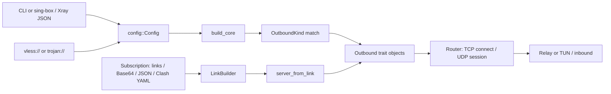

# Protocol Extension Architecture Audit

**Snapshot:** `main`, commit [`36b612e`](https://github.com/ERGFT/vpn-core/commit/36b612e619a99881f7d23adbd38403ac4134047a), 2026-11-07.\
**Purpose:** baseline technical report for the multi-protocol client roadmap.\
**Scope:** client core only; server implementation and GUI are out of scope.

## Conclusion

The project already has a suitable foundation for proxy protocols: the router depends on the `Outbound` object interface, TCP is a stream, and UDP is a `UdpSession`. A new extension system or router rewrite is unnecessary. Hysteria 2 can use this model after QUIC connection management, UDP sessions, shutdown, and network-change behavior are verified.

The current cost of adding a protocol comes from repeating its variant across `OutboundKind`, the large `OutboundConfig`, `check_fields`, sing-box/Xray parsers, `build_core`, subscription handling, and documentation. Improving configuration typing and isolating outbound construction are justified. Separating transport settings is also justified for the current VLESS/Trojan pair. Add architectural capabilities only when a real consumer needs them.

WireGuard should not be inserted as an ordinary `Outbound` without separate design: its model is IP packets and a TUN interface, not connections to an address and port. It needs a distinct system-tunnel integration point. Evaluate other protocols against their actual contracts.

## Current connection path

1. `Config::parse` routes JSON to the sing-box or Xray parser. They translate their supported subsets into common `InboundConfig`, `OutboundConfig`, and route models. Unknown and incompatible fields are rejected.
2. Standalone links become `VlessConfig`, `TrojanConfig`, and `Hysteria2Config`. Trojan reuses the VLESS parser with a placeholder UUID; its `transport` field is also a `VlessConfig`.
3. `build_core` validates outbounds and groups, creates DNS, outbounds and groups, connects detours and subscriptions, and builds rules and the router. Do not move the whole function into a “factory”: it assembles the application, not just protocols.
4. `Router` calls `Outbound::connect` for TCP or `Outbound::udp` for UDP. The outbound returns a `UdpSession` and manages its queues/network session. Groups and the tracker work above trait objects.
5. Subscription code separately parses link lines, sing-box JSON, and Clash YAML. VLESS and Trojan use `ServerFactory`; Hysteria 2 is built through the outbound integration, and unsupported protocols are counted in `skipped`.
6. `Controller::reload` builds a new set for new connections while existing ones retain the old configuration. `network_changed` resets DNS/TLS network dependencies and asks the tracker to close active connections. A new protocol must explicitly participate in this lifecycle.

## Architecture map

| Area | Role | Relevance to new protocols |
|---|---|---|
| `core/src/app/outbound.rs` | `Outbound` (`connect`, `udp`, tag, Clash type, server address, group) and `UdpSession` | Main proxy integration point, separated from the router |
| `core/src/app/config/mod.rs` | `OutboundKind`, common `OutboundConfig`, combination checks | Options are many `Option` fields; `check_fields` manually relates them to the kind |
| `core/src/app/config/singbox.rs`, `xray.rs` | external schema parsing and rejection of unsupported settings | Each format has its own supported protocol set; Xray need not accept features it does not represent |
| `core/src/app/mod.rs::build_core` | DNS, outbounds, groups, detours, subscriptions, rules, router | The kind match grows, but the full function is orchestration; extract construction only |
| `core/src/vless/uri.rs`, `core/src/trojan.rs` | links and protocol settings | Both transport models depend on `VlessConfig` |
| `core/src/transport/mod.rs` | `dial`/`open` choose a transport and return `AsyncStream` | Takes `VlessConfig`; `open` is already used by Trojan without a VLESS header |
| `core/src/app/subscription.rs`, `config/link.rs` | source adapters, link normalization, server creation and group refresh | Extend the fixed protocol set alongside the typed internal model |
| `ffi/` | C ABI, SDK, callback lifecycle | A protocol in existing JSON does not inherently require a C ABI change; retain ABI/SDK regression checks |
| `core/src/app/tun/` | system routes, TCP/IP stack, TUN | Proxy outbounds work through the router; packet VPNs need separate integration |

## Strengths to preserve

- Router and tracker use `Outbound`; TCP/UDP proxies do not need protocol-specific rewrites of rules, DNS, or accounting.
- Parsers reject unknown and incompatible fields and identify the problematic key. Do not replace this with silent ignoring.
- VLESS and Trojan have separate TCP/UDP implementations and packet formats. A shared interface does not require shared protocol internals.
- Subscriptions have multiple input adapters and a common server-construction step; secrets and server names have explicit protections.
- The project has integration and loopback tests, Xray/Go interoperability, fuzz targets, Windows/Linux CI, and ABI/SDK checks.

## Constraints and risks

1. **Weakly typed outbound model.** One `OutboundConfig` combines server protocols, proxies, `direct`, and groups. Invalid combinations are representable until manually rejected; new fields increase the risk of missed validation or secret redaction.
2. **Construction depends on the kind enum.** `build_core` constructs VLESS, Trojan, SOCKS5, and HTTP CONNECT. A static factory can localize this selection without a dynamic registry.
3. **Transport is described through VLESS.** `transport::dial/open` take `VlessConfig`, `TrojanConfig` stores it, and the VLESS parser contains common security/network/fingerprint fields. Separate shared TCP/TLS/REALITY settings while preserving VLESS, Vision, and REALITY behavior.
4. **Outbound capabilities are partial.** `Outbound` exposes a server address and TCP/UDP methods, but no unified, actively used contract for packet mode, chaining, and network changes; `UdpSession` is required even without UDP. Do not add unused flags; identify consumers first.
5. **Subscriptions use link strings.** Current JSON/YAML adapters normalize VLESS/Trojan. Support only formats that represent a future protocol and keep skipped entries explicit.
6. **Rust API compatibility may be affected.** `app` and `config` are exported from `reality_core`; removing public `OutboundConfig` fields can break Rust consumers. The C ABI is documented as the primary interface, but preserve it and establish Rust compatibility expectations.
7. **Network changes and shutdown.** QUIC can multiplex TCP and UDP, so independent sessions for each method may be wrong. Test cancellation, `reload`, `network_changed`, shutdown, and reconnection.

## What does not need a protocol-specific rewrite

Ordinary TCP/UDP proxies do not require rewriting the router, rules, DNS, tracker, or API. Preserve VLESS/Trojan implementations when their protocol behavior is unchanged. Adding a protocol through existing JSON does not inherently require a public C ABI change. Do not extract the whole transport system: share parts only where at least two real consumers and compatibility checks justify it.

Packet VPNs, Android/iOS platform adapters, route semantic changes, or a new public API need separate justification and PRs.

## Proposed small PRs for Stage 1

Adjust the sequence after designing the first patch. Do not merge before required checks pass.

| PR | Change | Scope and acceptance criteria |
|---|---|---|
| 1 | Typed outbound configuration variants | Separate common data, proxy options, VLESS/Trojan, and groups; preserve JSON, errors, redaction, and CLI/FFI parsing. Assess Rust API compatibility before removing public fields |
| 2 | Static proxy-outbound factory | Move only VLESS/Trojan/SOCKS/HTTP CONNECT construction out of `build_core`; keep DNS, groups, detours, router, and TUN composition there |
| 3 | Shared transport configuration | Decouple transport settings from `VlessConfig`, remove Trojan's placeholder UUID, preserve Vision/REALITY and transport interoperability |
| 4 | Minimal capability/lifecycle contract | Add only used properties (TCP, UDP, packets, chaining, network changes) and apply them in checks/TUN setup; do not create a generic IP-packet interface without a prototype |
| 5 | Typed subscription normalization | Separate link/JSON/YAML decoders from the common server model and factory; preserve skipped counts and unknown schemes |
| 6 | Internal test protocol | Use only `cfg(test)` or another proven non-production path; test settings, construction, TCP/UDP echo, errors, cancellation, shutdown, and reload; exclude it from production builds |
| 7 | Regression and architecture sign-off | Recheck old links/JSON, subscriptions, VLESS/Trojan interop, groups, reload, C ABI/SDK, and RU/EN docs; complete mandatory Stage 2 |

Change the order of PRs 1–5 if evidence shows an extraction does not reduce the cost of adding a real protocol. A dynamic registry or global router, DNS, or TUN rewrite is not justified.

### Implementation status on 2026-11-07

PRs #178–#183 are merged into `main`: typed settings, the static factory,
shared transport configuration, outbound capabilities, typed subscription
normalization, and a test protocol behind `cfg(test)` only. Stage 2 is complete:
PR #184 added direct checks for interruption of an active connection and core
shutdown during an active session, and the full CI passed before merge.

| Stage 2 requirement | Existing evidence | Status |
|---|---|---|
| Settings, TCP/UDP, unavailable TCP, UDP timeout, tracker cancellation, and outbound replacement | `core/src/app/protocol_architecture_test.rs`; fixture passed PR #183 CI | Verified in CI |
| Wrong Trojan password and real TCP/UDP/TLS/REALITY variants | `core/tests/interop_xray.rs::trojan_against_xray`, run by `scripts/interop_xray.sh` in Linux CI | Verified in CI |
| Reload preserves current sessions and applies new rules to new ones | `core/tests/app_api.rs::reload_keeps_open_connections_and_applies_new_rules`; fixture also replaces the router | Verified in CI |
| Groups, subscriptions, and configuration formats | `core/tests/app_groups.rs`, `core/src/app/subscription.rs`, and parser tests | Verified in CI |
| Public C ABI start/request/reload/stop | `ffi/tests/c_abi.rs::start_request_reload_stop` and CI ABI/SDK jobs | Verified in CI |
| UDP queue byte limit under concurrent sends | `core/src/app/vless_out.rs::queue_budget_tests`; atomic compare-exchange reservation | Verified in PR #184 CI |
| Active proxy connection interruption and core shutdown with an active session | `remote_interruption_ends_the_active_proxy_session` and `dropping_running_closes_an_active_proxy_session` in `core/tests/app_api.rs`; `Running::drop` cancels tracked connections | Verified in PR #184 CI |

VLESS queue-budget reservation is now atomic: concurrent senders cannot both
pass a stale-value check and collectively exceed the 4 MiB session budget. The
lifecycle check found that dropping `Running` stopped listeners but did not
signal cancellation to already tracked connections. `Running::drop` now calls
`Tracker::close_all`; integration tests check remote interruption and closure
of an active session during shutdown. [CI run #709](https://github.com/ERGFT/vpn-core/actions/runs/42360534173)
passed all eight job groups on the current commit: Linux interop/TUN, Windows,
Android, iOS, MSRV, coverage, audit, and secrets. PR #184 is merged into `main`.

## Baseline checks

| Check | Result in this run |
|---|---|
| `cargo fmt --all -- --check` | PASS |
| `python scripts/check_doc_links.py` | PASS, 55 documents (PR #185) |
| `cargo metadata --locked --no-deps --format-version 1` | PASS; 5 packages, MSRV `1.89` |
| `cargo test --locked --workspace` | Could not start: `link.exe` is missing from the installed MSVC environment; this is an environment limitation, not a confirmed project defect |
| `cargo clippy --locked --workspace --all-targets -- -D warnings` | Could not start for the same reason |

For the same commit, independent [GitHub CI run 673](https://github.com/ERGFT/vpn-core/actions/runs/42120316922) passed all eight job groups: Linux, real Windows, Android/iOS FFI builds, MSRV, coverage, audit, and secrets. The latest available [Fuzz run 37](https://github.com/ERGFT/vpn-core/actions/runs/42197496762) passed all nine fuzz targets. This confirms CI for that commit; it does not replace checks for future changes.

Local Rust toolchain: `1.99.0`; active target: `x86_64-pc-windows-msvc`; MSVC linker and Bash are absent from `PATH`. No local performance baseline was recorded because benchmarks were not run.

## Hysteria 2 entry criterion

Begin Hysteria 2 after Stage 1 changes, the internal TCP/UDP protocol, and Stage 2 regression checks. Demonstrate operation through the same router and groups, safe settings/secrets, subscription support in applicable formats, correct shutdown and `network_changed`, and unchanged C ABI.

Stages 1 and 2 are marked complete after PR #184 and documentation PR #185. PR #185 CI (run #711) passed all eight check groups on commit [`53ec432`](https://github.com/ERGFT/vpn-core/commit/53ec432da584043b195ec49b9c6c098d67e68409). Then Hysteria 2 plan PR #186 passed all 8 CI groups (run #713) and was merged to `main` as [`b7fb39b`](https://github.com/ERGFT/vpn-core/commit/b7fb39b62efd28722085290bf4fb2b797bc01914). These runs verify the baseline and documentation, not Hysteria 2 operation.

## Hysteria 2 preparation

PR #187 added the configuration model and strict `hysteria2://`/`hy2://` URI parser and was merged into `main` as [`aa8dab6`](https://github.com/ERGFT/vpn-core/commit/aa8dab644b19cd5e3641d53e62408c705e6c6b5a); PR #188 added URI subscriptions and a limited sing-box adapter and was merged as [`e43066b`](https://github.com/ERGFT/vpn-core/commit/e43066ba4fac86d21796e57a4237f9d28f4adafa). PRs #189 (QUIC/auth), #190 (TCP relay), #192 (UDP relay), #193 (Salamander), #196 (Hysteria BBR), #197/#198 (port hopping and docs), and #199 (outbound integration) are merged into `main`. PR #199 CI passed 16 checks and skipped 1. Later, CI #812 passed all 8 jobs and confirmed limited interoperability with the official v2.13.0 server: TCP echo, IPv4/IPv6 UDP in one association, and delivery of a 4096-byte payload. Port hopping selects a random initial port and rotates the protected UDP socket every 30 seconds, retaining the previous socket for 2 seconds. CI #823 showed that the response source port after a hop was reported to Quinn as a new remote endpoint; peer-address normalization has been added in PR #213 and awaits CI. Performance, network-interface changes, and connection recovery remain unverified. Other QUIC users retain Cubic; Quinn marks BBR experimental. Full rate negotiation and Brutal are not implemented. See the [Hysteria 2 plan](HYSTERIA2_IMPLEMENTATION_PLAN.en.md); support remains experimental.
