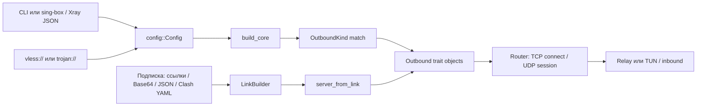

# Аудит архитектуры добавления протоколов

**Срез:** `main`, commit [`36b612e`](https://github.com/ERGFT/vpn-core/commit/36b612e619a99881f7d23adbd38403ac4134047a), 2026-11-07.\
**Назначение:** исходный технический отчёт к дорожной карте многопротокольного клиента.\
**Граница:** только клиентское ядро; сервер и GUI не рассматриваются.

## Вывод

У проекта уже есть подходящая основа для прокси-протоколов: маршрутизатор зависит от объектного интерфейса `Outbound`, TCP передаётся как поток, UDP — как `UdpSession`. Новая система расширений и переписывание маршрутизатора не нужны. Hysteria 2 можно подключить к этой модели после проверки управления QUIC-соединением, UDP-сессиями, остановкой и сменой сети.

Цена добавления протокола сейчас — повторение его варианта в `OutboundKind`, большом `OutboundConfig`, `check_fields`, парсерах sing-box/Xray, сборке `build_core`, обработчике подписок и документации. Обоснованно улучшить типизацию настроек и изолировать создание выходов. Разделение транспортных настроек оправдано для существующей пары VLESS/Trojan. Архитектурные возможности следует добавлять при наличии реального потребителя.

WireGuard нельзя без отдельного проектирования вставить как обычный `Outbound`: его модель — IP-пакеты и интерфейс TUN, а не соединения к адресу и порту. Для него потребуется отдельная точка интеграции с системным туннелем. Остальные протоколы нужно оценивать по их реальному контракту.

## Текущий маршрут подключения

1. `Config::parse` направляет JSON в парсер sing-box или Xray. Они переводят поддерживаемое подмножество в общие `InboundConfig`, `OutboundConfig` и модель маршрутов. Неизвестные и несовместимые поля отклоняются.
2. Отдельные ссылки разбираются в `VlessConfig` и `TrojanConfig`. Trojan повторно использует VLESS-парсер с фиктивным UUID; его поле `transport` тоже имеет тип `VlessConfig`.
3. `build_core` проверяет выходы и группы, создаёт DNS, выходы и группы, связывает detour и подписки, строит правила и router. Переносить всю функцию в «фабрику» не следует: она отвечает за сборку приложения, а не только за выбор протокола.
4. `Router` вызывает `Outbound::connect` для TCP или `Outbound::udp` для UDP. Выход возвращает `UdpSession` и сам управляет очередями/сетевой сессией. Группы и tracker работают поверх trait objects.
5. Подписки отдельно разбирают строки ссылок, sing-box JSON и Clash YAML. В этой ветке кода серверными схемами являются VLESS и Trojan; остальные протоколы учитываются в `skipped`. `ServerFactory` получает строку ссылки и общие параметры `ServerOpts`.
6. `Controller::reload` строит новый набор для новых соединений, а уже открытые оставляет на старой конфигурации. `network_changed` сбрасывает DNS/TLS сетевые зависимости и просит tracker закрыть активные соединения. Новый протокол должен явно участвовать в этом жизненном цикле.

## Карта архитектуры

| Участок | Роль | Значение для новых протоколов |
|---|---|---|
| `core/src/app/outbound.rs` | `Outbound` (`connect`, `udp`, tag, тип Clash, адрес сервера, группа) и `UdpSession` | Основная точка интеграции прокси; реализация отделена от router |
| `core/src/app/config/mod.rs` | `OutboundKind`, общий `OutboundConfig`, проверки сочетаний | Параметры представлены множеством `Option`; `check_fields` вручную связывает поля с видом выхода |
| `core/src/app/config/singbox.rs`, `xray.rs` | разбор внешних схем, отклонение неподдерживаемых настроек | У каждого формата свой список поддерживаемых протоколов; Xray не обязан принимать отсутствующие в нём функции |
| `core/src/app/mod.rs::build_core` | DNS, выходы, группы, detour, подписки, правила и router | Match по типам растёт, но вся функция — orchestration; извлекать следует только создание выходов |
| `core/src/vless/uri.rs`, `core/src/trojan.rs` | ссылки и параметры протоколов | Обе модели транспорта завязаны на `VlessConfig` |
| `core/src/transport/mod.rs` | `dial`/`open` выбирают транспорт и возвращают `AsyncStream` | Аргумент — `VlessConfig`; `open` уже используется Trojan без заголовка VLESS |
| `core/src/app/subscription.rs`, `config/link.rs` | адаптеры источников, нормализация к ссылкам, создание сервера и обновление групп | Фиксированный набор протоколов нужно расширять вместе с типизированной внутренней моделью |
| `ffi/` | C ABI, SDK и callback lifecycle | Новый JSON-протокол сам по себе не требует менять ABI; сохранить проверки ABI/SDK |
| `core/src/app/tun/` | системные маршруты, TCP/IP-стек, TUN | Обычный proxy-выход работает через router; пакетный VPN требует отдельной интеграции |

## Что уже хорошо работает

- Router и tracker используют `Outbound`; TCP/UDP-прокси не требуют индивидуально переписывать правила, DNS и учёт соединений.
- Парсеры отклоняют неизвестные и несовместимые поля с указанием проблемного ключа. Нельзя заменять это молчаливым игнорированием.
- VLESS и Trojan имеют отдельные реализации TCP/UDP и пакетов. Общий интерфейс не требует унифицировать их внутреннюю работу.
- Подписки имеют разные адаптеры входных форматов и общий этап создания сервера; секреты и имена серверов защищаются явно.
- Есть интеграционные и loopback-тесты, interop с Xray/Go, fuzz-цели, Windows/Linux CI и проверки ABI/SDK.

## Ограничения и риски

1. **Слабая типизация выхода.** Один `OutboundConfig` объединяет серверные протоколы, proxy, `direct` и группы. Неверные сочетания представимы до серии ручных проверок; новые поля повышают риск пропустить валидацию или маскирование секрета.
2. **Сборка зависит от перечисления видов.** `build_core` содержит создание VLESS, Trojan, SOCKS5 и HTTP CONNECT. Статическая фабрика может локализовать этот выбор без динамического реестра.
3. **Транспорт описан через VLESS.** `transport::dial/open` принимают `VlessConfig`, `TrojanConfig` хранит его, а VLESS-парсер содержит общие security/network/fingerprint-поля. Выделить общую транспортную конфигурацию для реально общих TCP/TLS/REALITY путей, сохранив особенности VLESS, Vision и REALITY.
4. **Возможности выходов описаны частично.** `Outbound` выдаёт адрес сервера и TCP/UDP методы, но нет единого используемого контракта для пакетного режима, цепочек и смены сети; `UdpSession` обязателен даже там, где UDP отсутствует. Не добавлять неиспользуемые флаги: сначала зафиксировать потребителей.
5. **Подписки используют строки ссылок.** Текущие JSON/YAML адаптеры нормализуют VLESS/Trojan. Для будущего протокола поддерживать только применимые форматы и сохранять явный учёт пропусков.
6. **Возможна несовместимость Rust API.** `app` и `config` экспортируются из `reality_core`; удаление публичных полей `OutboundConfig` может ломать Rust-потребителей. C ABI обозначен основным интерфейсом, но нужно сохранить ABI и установить границы обещаний Rust-совместимости.
7. **Смена сети и остановка.** QUIC может мультиплексировать TCP и UDP, поэтому независимое создание сессии на каждый метод может быть неверным. Нужны тесты отмены, `reload`, `network_changed`, остановки и восстановления.

## Что не требует индивидуальной переделки

Для обычного TCP/UDP-прокси не требуется переписывать router, правила, DNS, tracker и API. Существующие реализации VLESS/Trojan сохраняются без внутренних изменений протокола. Добавление протокола через существующую JSON-конфигурацию само по себе не требует менять публичный C ABI. Не нужно выделять всю систему транспортов сразу: общие части выносятся там, где минимум два реальных потребителя и есть проверки совместимости.

Пакетный VPN, платформенные адаптеры Android/iOS, изменение семантики маршрутов или новый публичный API требуют отдельного обоснования и PR.

## План небольших PR этапа 1

Порядок уточняется по результатам проектирования первого патча. Слияние — только после обязательных проверок.

| PR | Изменение | Граница и критерии |
|---|---|---|
| 1 | Типизированные варианты конфигурации | Разделить общие сведения, proxy-поля, VLESS/Trojan и группы; сохранить JSON, ошибки, redaction и CLI/FFI разбор. До удаления публичных полей оценить Rust API |
| 2 | Статическая фабрика proxy-выходов | Вынести только построение VLESS/Trojan/SOCKS/HTTP CONNECT; DNS, группы, detour, router и TUN остаются в orchestration |
| 3 | Общая транспортная конфигурация | Отвязать транспорт от `VlessConfig`, убрать фиктивный UUID Trojan, сохранить Vision/REALITY и interop всех транспортов |
| 4 | Минимальный контракт возможностей/lifecycle | Добавить только реально используемые свойства (TCP, UDP, пакеты, цепочки, смена сети) и применять их в проверках/TUN; не делать общий IP-packet интерфейс без прототипа |
| 5 | Типизированная нормализация подписок | Отделить link/JSON/YAML decoder-ы от общей модели сервера и фабрики; сохранить счётчик пропусков и не маскировать неизвестные схемы |
| 6 | Внутренний тестовый протокол | Только `cfg(test)` или доказанно непубликуемый путь; проверить настройки, создание, TCP/UDP echo, ошибки, отмену, остановку и reload, исключив production-сборки |
| 7 | Регрессия и фиксация архитектуры | Повторно проверить старые ссылки/JSON, подписки, VLESS/Trojan interop, группы, reload, C ABI/SDK и RU/EN документацию; завершить обязательный этап 2 |

Порядок PR 1–5 меняется, если доказательства показывают, что извлечение не снижает стоимость добавления реального протокола. Динамический реестр и глобальная переделка router, DNS или TUN не обоснованы.

### Статус реализации на 2026-11-07

PR #178–#183 влиты в `main`: типизированные настройки, статическая фабрика,
общая транспортная конфигурация, возможности выходов, типизированная
нормализация подписок и тестовый протокол только под `cfg(test)`. Этап 2
завершён: PR #184 добавил проверку прерывания активного соединения и остановки
ядра при активной сессии; полный CI прошёл до слияния.

| Требование этапа 2 | Имеющееся доказательство | Статус |
|---|---|---|
| Настройки, TCP/UDP, недоступный TCP, UDP timeout, отмена tracker и замена outbound | `core/src/app/protocol_architecture_test.rs`; fixture прошёл CI PR #183 | Проверено в CI |
| Неверный пароль Trojan и реальные TCP/UDP/TLS/REALITY варианты | `core/tests/interop_xray.rs::trojan_against_xray`, запускается через `scripts/interop_xray.sh` в Linux CI | Проверено в CI |
| Reload сохраняет текущие соединения и применяет новые правила к новым | `core/tests/app_api.rs::reload_keeps_open_connections_and_applies_new_rules`; fixture дополнительно заменяет router | Проверено в CI |
| Группы, подписки и форматы конфигураций | `core/tests/app_groups.rs`, тесты `core/src/app/subscription.rs` и парсеров | Проверено в CI |
| Публичный C ABI: start/request/reload/stop | `ffi/tests/c_abi.rs::start_request_reload_stop` и ABI/SDK jobs CI | Проверено в CI |
| Лимит байтов UDP-очереди при параллельных отправках | `core/src/app/vless_out.rs::queue_budget_tests`; атомарное резервирование через compare-exchange | Проверено в CI PR #184 |
| Прерывание активного прокси-соединения и остановка ядра при активной сессии | `remote_interruption_ends_the_active_proxy_session` и `dropping_running_closes_an_active_proxy_session` в `core/tests/app_api.rs`; `Running::drop` отменяет tracker-соединения | Проверено в CI PR #184 |

Резервирование лимита очереди VLESS теперь атомарно: конкурентные отправители
не могут оба пройти проверку старого значения и вместе превысить общий лимит
4 MiB. Проверка жизненного цикла выявила, что уничтожение `Running` останавливало
слушатели, но не сигнализировало отмену уже отслеживаемым соединениям. Теперь
`Running::drop` вызывает `Tracker::close_all`; интеграционные тесты проверяют
прерывание сервером и закрытие активной сессии при остановке. [CI run #709](https://github.com/ERGFT/vpn-core/actions/runs/42360534173)
прошёл все восемь job-групп на актуальном коммите: Linux interop/TUN,
Windows, Android, iOS, MSRV, coverage, audit и secrets. PR #184 влит в `main`.

## Исходные проверки

| Проверка | Результат этого запуска |
|---|---|
| `cargo fmt --all -- --check` | PASS |
| `python scripts/check_doc_links.py` | PASS, 55 документов (PR #185) |
| `cargo metadata --locked --no-deps --format-version 1` | PASS; 5 пакетов, MSRV `1.89` |
| `cargo test --locked --workspace` | Не стартовал: в установленной среде MSVC отсутствует `link.exe`; это ограничение окружения, не подтверждённый дефект проекта |
| `cargo clippy --locked --workspace --all-targets -- -D warnings` | Не стартовал по той же причине |

Для того же commit независимый [GitHub CI run 673](https://github.com/ERGFT/vpn-core/actions/runs/42120316922) прошёл все восемь job-групп: Linux, настоящую Windows, Android/iOS FFI-сборки, MSRV, coverage, audit и secrets. Последний доступный [Fuzz run 37](https://github.com/ERGFT/vpn-core/actions/runs/42197496762) прошёл все девять fuzz-целей. Это подтверждает CI для указанного commit, но не заменяет проверки будущих изменений.

Локальный Rust `1.99.0`; активная цель `x86_64-pc-windows-msvc`; MSVC linker и Bash отсутствуют в `PATH`. Локальный baseline производительности не снимался: бенчмарки не запускались.

## Условие перехода к Hysteria 2

Начинать Hysteria 2 после изменений этапа 1, внутреннего TCP/UDP протокола и регрессионных проверок этапа 2. Нужно доказать работу через тот же router и группы, безопасную загрузку настроек/секретов, поддержку применимых форматов подписок, корректные остановку и `network_changed`, неизменность существующего C ABI.

Этапы 1 и 2 отмечены завершёнными после PR #184 и документационного PR #185. CI PR #185 (run #711) прошёл все восемь групп проверок на commit [`53ec432`](https://github.com/ERGFT/vpn-core/commit/53ec432da584043b195ec49b9c6c098d67e68409). Затем PR #186 с планом Hysteria 2 прошёл все 8 групп CI (run #713) и объединён в `main` как [`b7fb39b`](https://github.com/ERGFT/vpn-core/commit/b7fb39b62efd28722085290bf4fb2b797bc01914). Эти прогоны подтверждают базовую совместимость и документацию, но не проверяют работу Hysteria 2.

## Подготовка Hysteria 2

PR #187 добавил модель конфигурации и строгий разбор `hysteria2://`/`hy2://` и объединён в `main` как [`aa8dab6`](https://github.com/ERGFT/vpn-core/commit/aa8dab644b19cd5e3641d53e62408c705e6c6b5a); PR #188 добавил URI-подписки и ограниченный адаптер sing-box и объединён как [`e43066b`](https://github.com/ERGFT/vpn-core/commit/e43066ba4fac86d21796e57a4237f9d28f4adafa). PR #189 (QUIC/auth), #190 (TCP relay), #192 (UDP relay), #193 (Salamander), #196 (BBR) и #197 (port hopping) слиты в `main`. CI #759 и #761 прошли 8/8 jobs; последний проверил head `3762074`. Port hopping выбирает случайный начальный порт и меняет защищённый UDP socket каждые 30 секунд, сохраняя предыдущий socket ещё 2 секунды. Эталонная interop, производительность, смена сетевого интерфейса и восстановление соединения не проверялись. Прочие QUIC-потребители сохраняют Cubic; BBR в Quinn помечен experimental. Полная rate negotiation и Brutal пока не реализованы, production factory не подключена. План интеграции находится в [плане Hysteria 2](HYSTERIA2_IMPLEMENTATION_PLAN.md); поддержку нельзя заявлять до reference interop и интеграционных проверок.
